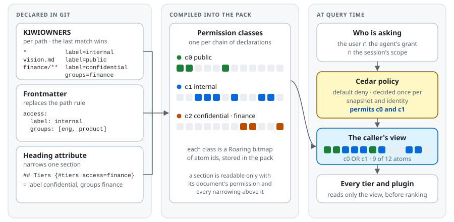

<p align="center">
  
</p>

<h1 align="center">Kiwi</h1>

<p align="center">
  <b>A governed knowledge engine for agents.</b><br>
  Markdown in Git, compiled into one immutable pack per commit, served over MCP with permissions down to a single section.
</p>

<p align="center">
  <a href="LICENSE"></a>
  <a href="https://www.rust-lang.org"></a>
</p>

<p align="center">
  <a href="#quickstart">Quickstart</a> · <a href="#connect-an-agent">Connect an agent</a> ·
  <a href="#how-it-works">How it works</a> · <a href="#governance">Governance</a> ·
  <a href="#benchmarks">Benchmarks</a> · <a href="docs/design.md">Design</a> ·
  <a href="docs/configuration.md">Configuration</a> · <a href="docs/deploy.md">Deploy</a>
</p>

---

Agents that work for people need the team's requirements, designs and decisions, with
exactly the permissions those people have, and without spending thousands of tokens
skimming whole documents. Kiwi compiles each commit of a Markdown knowledge base into
one file, the **Kiwi Pack**, and answers agents from it through six MCP tools. Every
section is an atom an agent can read at three levels of detail, and content a person
may not read never reaches their agent: not in results, not in snippets, not in scores.

## Why it is different

- **Permissions are compiled into the index and applied before ranking.** `KIWIOWNERS`,
  frontmatter and heading attributes become permission classes, each a bitmap of
  sections. A [Cedar](https://www.cedarpolicy.com/) policy picks the classes that the
  user, the agent's grant and the token's scopes may all read, and every retrieval tier runs
  inside that view. BM25 computes its statistics from the view alone.
- **One immutable pack per commit, pinned in every answer.** A build reads a commit's
  tree without a checkout and writes one content-addressed, memory-mapped pack. Every
  response carries the `snapshot` it was answered from, and the same snapshot and
  request return the same bytes.
- **Atoms, zoom levels and token budgets.** Each heading-bounded section is an atom with
  an L0 (title and breadcrumb), an L1 (an abstract) and an L2 (the full text), each with
  a token count. Agents map, search, then read whole documents; every answer is cut to a
  budget the agent may raise, and a read the budget cut says what it left out and how
  to read on.
- **Writes are pull requests, governed like reads.** `kiwi_propose` commits to a new
  branch, lints the result and opens a pull request. The policy decides who may propose
  a change to each section and who may merge without review, and a proposal is judged
  on the caller's view, so it cannot probe hidden content.
- **One binary, no database, no model required.** `kiwi` is a single Rust binary and a
  pack is a file. BM25 and exact lookups need no model; vectors (a local ONNX model or
  any OpenAI-compatible API) and a cross-encoder rerank are optional. No generative
  model runs in the query path.

| Approach | What it lacks for agents |
| --- | --- |
| Wikis (Confluence, Outline) | Content outside Git; permissions per page; APIs return whole pages |
| Markdown search over MCP | No permissions, no snapshots, no audit |
| RAG on a vector database | Chunks cut by size; permissions often applied after ranking; one more database to run |
| MCP permission gateways | Allow or deny whole tools; blind to what is inside a document |

## Quickstart

Build from source with Rust 1.95 or newer, then compile the bundled example corpus (a
fictional marketplace, Acme) and search it as Alice, an engineer:

```sh
git clone https://github.com/justvinhhere/cooly-kiwi && cd cooly-kiwi
cargo build --release && export PATH="$PWD/target/release:$PATH"
kiwi build fixtures/acme-kb --embedder hash   # no model; without the flag: multilingual-e5-small
kiwi query fixtures/acme-kb kiwi_search \
  '{"queries": ["double charge prevention", "idempotency key"]}' --principal alice
```

```jsonc
{
  "snapshot": "7615fc543de8ff5bf56fa584dba38226bdd885ea",   // the commit it answers from
  "results": [
    { "id": "glossary#idempotency-key", "level": "L1", "title": "GLOSSARY · Glossary › Idempotency key",
      "summary": "A unique value the client generates once per logical write operation and sends with every retry of it.",
      "status": "approved", "score": 0.1268, "why": ["bm25", "exact", "vec"] },
    // … 19 more: 10 for each query
  ],
  "omitted": 57, "budget": { "limit": 2000, "used": 1189 },
  "warnings": [ { "kind": "redirected", "id": "adr/adr-003-sync-capture#decision", "to": "adr/adr-007-async-capture#decision" } ]
}
```

The checkout PRD's pricing section is confidential to finance. Alice cannot tell that it
exists; Fiona, in finance, reads it:

```sh
kiwi query fixtures/acme-kb kiwi_read '{"ids": ["product/checkout/prd#pricing"]}' --principal alice
# {"snapshot":"7615fc5…","atoms":[],"not_found":["product/checkout/prd#pricing"],"budget":{"limit":12000,"used":0}}
kiwi query fixtures/acme-kb kiwi_read '{"ids": ["product/checkout/prd#pricing"]}' --principal fiona
kiwi query fixtures/acme-kb kiwi_trace '{"id": "PRD-001", "depth": 2}' --principal alice  # PRD → ADRs → code
```

A read gives whole documents. When its budget cuts one short, the answer says what it
left out and how to read on:

```sh
kiwi query fixtures/acme-kb kiwi_read '{"ids": ["ADR-005"], "budget": 300}' --principal alice
```

```jsonc
{
  "atoms": [ { "id": "adr/adr-005-idempotency-keys", "tokens": 267,
    "sections": ["adr/adr-005-idempotency-keys", "adr/adr-005-idempotency-keys#context"], /* text, cite, links */ } ],
  "budget": { "limit": 300, "used": 267 },
  "more": { "sections": 3, "tokens": 503,
    "left_out": ["adr/adr-005-idempotency-keys#decision", "adr/adr-005-idempotency-keys#consequences",
                 "adr/adr-005-idempotency-keys#alternatives"],
    "next": { "ids": ["ADR-005"], "budget": 300, "after": "adr/adr-005-idempotency-keys#context" } }
}
```

## Connect an agent

Over stdio, with `claude mcp add kiwi -- kiwi serve /path/to/kb --agent claude-code` or in any MCP client:

```json
{ "mcpServers": { "kiwi": { "command": "kiwi", "args": ["serve", "/path/to/kb", "--agent", "claude-code"] } } }
```

The agent must be listed in `.kiwi/principals.yaml` (any other gets `default_agent`'s
grant). The user is `--principal`, `KIWI_PRINCIPAL` or the repository's `git config
user.email`, an assertion by whoever starts the process: stdio keeps an agent inside its
user's view, it does not authenticate the user.

Over HTTP, Kiwi is an OAuth 2.1 resource server. It validates bearer tokens from your
authorization server (HS256, RS256 or ES256 keys, or a JWKS file; `iss`, `aud`, `exp`,
`nbf`), requires a `kiwi:read` or `kiwi:label:<label>` scope, maps `sub` to the user and
`client_id` to the agent, and publishes `/.well-known/oauth-protected-resource`.

```sh
kiwi serve /path/to/kb --http 127.0.0.1:8740 --auth-hs256-env KIWI_TOKEN_SECRET \
  --issuer https://auth.example.com --resource https://kiwi.example.com/mcp \
  --allowed-host kiwi.example.com
```

`kiwi serve kb-a kb-b` federates several knowledge bases by namespace, each with its own
policy and audit log; `--packs` and `--state` then hold one directory per namespace. In
production, build on a schedule and let the server follow (here the namespaces are `kb`
and `catalogue`):

```sh
kiwi build /srv/kb --packs /var/lib/kiwi/packs/kb                # on a timer, as the builder
kiwi build /srv/catalogue --packs /var/lib/kiwi/packs/catalogue
kiwi serve /srv/kb /srv/catalogue --follow \
  --packs /var/lib/kiwi/packs --state /var/lib/kiwi/state --http 127.0.0.1:8740 …
```

With `--follow` the server never builds: it serves each store's current pack and swaps
in every new one with the policy of its snapshot as soon as a build makes it current
(or on `SIGHUP`). Calls in flight finish on the pack they started with; none fails or
waits. [docs/deploy.md](docs/deploy.md) sets up a server for a team step by step (the
timer, proposals as pull requests, tokens, several corpora, audit, upgrades); every
option is in [docs/configuration.md](docs/configuration.md).

## How it works

<picture>
  <source media="(prefers-color-scheme: dark)" srcset="assets/diagrams/architecture-dark.svg">
  
</picture>

At build time the compiler splits each document into atoms at its headings, groups them
into permission classes, and resolves the typed graph (`implements`, `decided_by`,
`supersedes`, `amends`, `code`) and the glossary. Indexer plugins add BM25 postings
partitioned by permission class and binary-quantized vectors; the result is one
[rkyv](https://rkyv.org) archive read zero-copy through `mmap`. A rebuild compiles only
changed documents and re-embeds only changed atoms. At query time the policy gate turns
the caller into a view, and the planner runs a cascade inside it: exact lookups of ids
and glossary terms, filters and graph hops, BM25, vectors, rank fusion, an optional
rerank, then the token-budget cut. Every answer appends one record to a hash-chained
audit log. [docs/design.md](docs/design.md) has the full design and its reasons.

## The six tools

| Tool | Main input | Returns |
| --- | --- | --- |
| `kiwi_map` | `scope`, `depth`, `budget` | The L0/L1 tree of a scope (an atom id, a path prefix or a namespace) |
| `kiwi_search` | `queries[]`, `filters`, `budget`, `limit` | Ranked atoms at L1 or L0, why they matched, their status; every query answered |
| `kiwi_read` | `ids[]`, `level`, `context`, `budget`, `after` | Whole documents or sections at L2 (or L0/L1), typed links, optional parent, siblings and children; `more` when the budget cut it |
| `kiwi_trace` | `id`, `relation`, `direction`, `depth` | A walk of the typed graph, e.g. PRD → RFC → ADR → code |
| `kiwi_propose` | `changes[]`, `rationale`, `title` | The branch and pull request, whether review is needed, lint findings |
| `kiwi_feedback` | `query`, `ids`, `verdict` | Records useful, wrong or missing; `missing` feeds `kiwi gaps` |

Responses carry `warnings` where they apply (overdue review, unapproved, deprecated,
redirected, degraded); `kiwi://atom/{id}@{rev}` returns one atom at a pinned snapshot.

When a request names no budget, Kiwi sizes answers for long research: a map gets 4,000
tokens, a search 1,000 tokens and 10 results for each of its queries (each query also
keeps its own best three), and a read 12,000 tokens of text, whole documents first. No
answer exceeds 32,000 tokens. A read the budget cut carries `more`: the sections left
out and `next`, the arguments of the `kiwi_read` that reads on. The defaults are set in
`.kiwi/kiwi.toml` (`map.budget`, `search.budget`, `search.limit`, `read.budget`;
[docs/configuration.md](docs/configuration.md)).

Over HTTP the endpoint is stateless: every request is authenticated and answered on its
own, so there is no session to expire, however long an agent works between calls.

## Governance

<picture>
  <source media="(prefers-color-scheme: dark)" srcset="assets/diagrams/governance-dark.svg">
  
</picture>

Access is declared in the repository, next to the content, and reviewed like code:

```text
# KIWIOWNERS: CODEOWNERS style, the last matching line wins
*            label=internal  owner=@team-docs
vision.md    label=public
finance/**   label=confidential groups=finance
```

A document's frontmatter replaces its path rule
(`access: { label: confidential, groups: [legal] }`), and a heading attribute narrows
one section (`## Pricing {#pricing access=finance}`). Declarations fail closed: a
malformed one stops the build. Plugins are principals too, so an embeddings API or an
HTTP reranker receives only what the policy lets `plugin:<name>` read on the network.
`kiwi policy test` runs the policy's unit tests; `kiwi audit verify` checks the audit
log's hash chain, and `kiwi audit export` ships its verified records.

**The guarantee:** with the default `bm25_stats = "strict"`, what a caller receives
depends only on what the caller may read. The leak suite
([`leak.rs`](crates/kiwi-cli/tests/leak.rs)) tests it for every principal in
[`bench/principals.yaml`](bench/principals.yaml) on a corpus seeded with adversarial
documents: it rewrites the corpus without everything that principal may not see, and
every search, map, read, trace and proposal answer must stay byte-identical (apart from
snapshot and branch ids), and no response may name a hidden atom or contain a canary
word from a hidden section. [`federation.rs`](crates/kiwi-cli/tests/federation.rs) does
the same across two federated corpora. [SECURITY.md](SECURITY.md) states what Kiwi does
and does not protect.

## Benchmarks

`bench/run.sh` is the benchmark suite: search quality, latency percentiles, build and
reload times and pack sizes on fixed corpora, checked against `bench/baselines/` on
every release. On the bundled corpus (146 atoms, 44 answerable questions and 4 whose
answers are hidden from the asker, 7 principal and agent pairs):

| Mode | recall@5 | recall@10 | MRR | p95 |
| --- | ---: | ---: | ---: | ---: |
| bm25 | 0.848 | 0.947 | 0.677 | 0.075 ms |
| bm25 + vectors (`multilingual-e5-small`) | 0.917 | 0.936 | 0.743 | the query embedding |
| bm25 + vectors + local rerank of the top 10 | 0.902 | 0.936 | 0.917 | about 0.1 s a passage |

None of these modes returned a hidden answer; the leak checks found 0 violations in 555
responses. A catalogue of 10,000 short records answers a BM25 search in 0.21 ms at p95
and swaps in a new pack in 15 ms; 100,000 synthetic atoms build in 14 s, rebuild after
a one-file change in 1.7 s and answer a BM25 search in 2.0 ms at p95 (AMD Ryzen 5
5600G, Ubuntu 22.04, release build, in-process). [docs/design.md](docs/design.md#results)
has every table, the machines and the commands.

## Skills for agents

[`skills/`](skills) holds three Agent Skills: [`kiwi-answer`](skills/kiwi-answer/SKILL.md)
answers questions with few tokens and exact citations,
[`kiwi-write`](skills/kiwi-write/SKILL.md) changes the knowledge base through
`kiwi_propose`, and [`kiwi-author`](skills/kiwi-author/SKILL.md) sets up a corpus and
its governance. Install them with `cp -R skills/kiwi-* ~/.claude/skills/`.

## Contributing, security, license

- Contributing: [CONTRIBUTING.md](CONTRIBUTING.md) and the [code of conduct](CODE_OF_CONDUCT.md).
- Security: a permission leak is a security bug; report it privately as [SECURITY.md](SECURITY.md) describes.
- License: [Apache-2.0](LICENSE).
