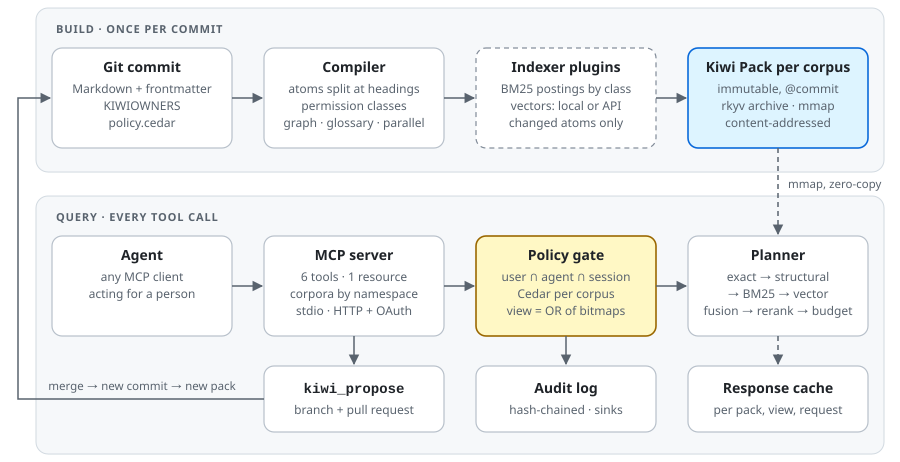
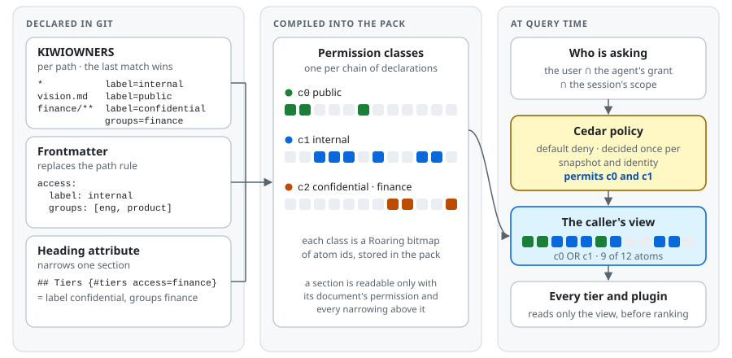
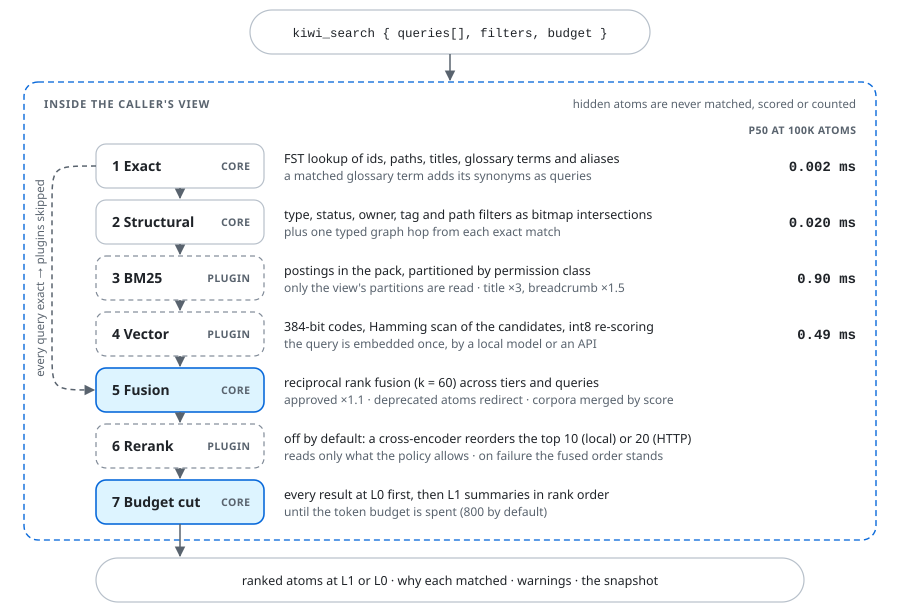

# Kiwi design

This document describes how Kiwi works and why it is built that way. It is written
from the code in this repository; where it names a number, the number is either a
constant in the code or a measurement from `kiwi bench` ([Results](#results) has the
machine and the full tables). Every
configuration key, file format and flag is listed in [configuration.md](configuration.md).

## Contents

- [Principles](#principles)
- [Two phases: build and query](#two-phases-build-and-query)
- [The Kiwi Pack](#the-kiwi-pack)
- [Atoms and zoom levels](#atoms-and-zoom-levels)
- [Documents, metadata and the typed graph](#documents-metadata-and-the-typed-graph)
- [Governance compiled into the index](#governance-compiled-into-the-index)
- [The retrieval cascade](#the-retrieval-cascade)
- [Federation](#federation)
- [Writes through Git](#writes-through-git)
- [The plugin model](#the-plugin-model)
- [MCP tools](#mcp-tools)
- [Defaults](#defaults)
- [Results](#results)

## Principles

These principles settle design arguments.

1. **Markdown in Git is the only source of truth.** Indexes, embeddings and bitmaps
   are caches: delete them and they can be rebuilt from any commit.
2. **Compile, do not serve.** Work that grows with the size of the corpus happens at
   build time. At query time Kiwi only does work that grows with the size of the
   answer: memory-mapped reads, bitmap operations and small scans.
3. **Tokens are the unit of cost.** An agent's turn costs seconds and thousands of
   tokens. Saving a millisecond matters less than saving a few thousand tokens of
   context, so every response is cut to a token budget.
4. **The agent is the brain; the engine is a cheap sense.** No generative model runs in
   the query path. Query expansion and the final choice of what to read are left to the
   calling agent, which is already a capable model; the only models a query may touch
   are small encoders (a query embedding, an optional cross-encoder).
5. **Governance comes before retrieval.** The default is deny. Content is filtered to
   what the caller may see before anything is ranked, never after.
6. **A microkernel.** The core is the compiler, the pack, the policy gate, the planner
   and the MCP server. Lexical and semantic search are plugins. With every plugin off,
   Kiwi still answers by map, read and exact lookups.
7. **Every answer is pinned to a snapshot.** Responses carry the commit they were
   computed from, so they are reproducible, cacheable without invalidation, and can
   answer "what did we know then".
8. **Idle costs nothing.** A pack is a static file and the server holds no state that
   cannot be rebuilt, so it starts in milliseconds and can scale to zero.

## Two phases: build and query

<picture>
  <source media="(prefers-color-scheme: dark)" srcset="../assets/diagrams/architecture-dark.svg">
  
</picture>

`kiwi build` turns one snapshot of a corpus into one Kiwi Pack:

1. **Read the snapshot** (`kiwi-compiler/src/source.rs`). A Git source reads blobs
   straight from the commit's tree with `gix`, without a checkout, and pins the
   snapshot to the commit hash. A directory source (`--worktree`) reads the working
   files and pins the snapshot to `dir:<hash of their content>`.
2. **Compile each document** (`compile.rs`), in parallel: parse frontmatter and
   Markdown with `pulldown-cmark`, split it into atoms, resolve its access, count
   tokens. A compiled document depends only on its bytes, its resolved access and the
   configuration, so it is cached (as an rkyv file) by the BLAKE3 hash of those three;
   an unchanged corpus compiles no atom.
3. **Link** (`link.rs`): assign atom uids, group atoms into permission classes, build
   the facet bitmaps, the exact-match dictionary, the glossary and the typed graph. The
   compressed body of an atom whose content hash is unchanged is copied from the
   previous pack.
4. **Index**: run the indexer plugins, each producing one segment keyed by atom uid and
   receiving its previous segment, so work is redone only for changed atoms: BM25
   re-analyses only atoms whose text changed, vectors re-embed only those.
5. **Store**: write the pack to `.kiwi/packs/<blake3>.kpack` through a temporary file,
   `fsync` and an atomic rename, and point `CURRENT` at it. A pack whose content hash
   already exists is not written again. Builds of one store take an exclusive lock, so
   concurrent builds (a `--watch` server and a CI job) run one after the other; readers
   never wait, and a failed build leaves the previous pack current. After the build,
   old packs are removed: the store keeps the current pack and the newest before it,
   `packs.keep` in all (10 by default; `kiwi gc` prunes by hand), and their snapshots
   leave the index.

The pack is one file and is rewritten whole by every build that changes anything; at
100,000 atoms (a pack of about 157 MB) that write is most of a one-file rebuild.

`kiwi serve` then answers MCP calls from the pack of the snapshot its governance was
read from: the commit of `--rev` (or `HEAD`), or for a directory the files as they are
now (`dir:<hash>`, the id a build of the same files gives its pack). `kiwi query`,
`export` and `gaps` do the same. A snapshot without a pack is refused, never answered
from another one: the current pack under an older revision's policy could show what
that policy hides. Each call resolves the
caller to an identity, asks the policy gate for the caller's view, runs the planner on
that view, caches the response bytes and appends one audit record. With `--watch`, the
server rebuilds what it serves when that changes (with `--worktree`, a file under the
corpus; otherwise `HEAD` or a branch of the repository, so it keeps serving commits,
never the working files) and then serves the new pack
together with the policy, principals, configuration and audit sinks read from the same
snapshot, swapped at once: a call takes one such state and answers from it throughout,
so no answer mixes a new pack with an old policy. A snapshot without a policy, or one
that fails to load, leaves the previous state serving; a namespace change and rerank
settings need a restart.

With `--follow`, building is someone else's job (`kiwi build` on a timer, in CI, as
another user) and the server only reads: it serves the pack its store's `CURRENT`
names and, each time a build moves `CURRENT`, the new pack with the policy,
principals and configuration of that pack's own snapshot, swapped in the same way.
A build writes the pack first and replaces `CURRENT` last, by an atomic rename, so the
server never sees a pointer to a partial file. Three triggers lead to one idempotent
check (`kiwi-cli/src/follow.rs`): a file system notification on the store, `SIGHUP`,
and a re-read every 30 seconds in case a notification is lost; a check that finds the
served pack current does nothing. Calls in flight finish on the state they took, new
calls take the new one, and no call waits for or fails because of a swap; the old
pack's memory map stays valid after `gc` removes its file. A pack of a kind the server
does not serve (a `dir:` snapshot on a server of commits, or the reverse), or one
whose snapshot's policy fails to load, is reported on standard error and the previous
state keeps serving until the next build.

## The Kiwi Pack

A pack (`kiwi-core/src/pack.rs`, `model.rs`) is one immutable, content-addressed file:
a 32-byte header (`KIWIPACK`, the format version, reserved bytes) followed by an
[rkyv](https://rkyv.org) archive in rkyv's unaligned format, so plugin segments are
themselves rkyv archives readable in place at any offset. The archive is validated once
when the pack is opened (on a cold page cache this read of the whole file dominates
start-up); every later read is zero-copy from the memory map. It holds:

| Part | Contents |
| --- | --- |
| Header data | format version, namespace, snapshot, source kind, snapshot date, Kiwi version, configuration hash |
| Documents | path, id, metadata, root atom, range of atoms |
| Atoms | id, anchor, parent, L0, L1, token counts per level, content hash, permission class |
| Bodies | L2 text, compressed with zstd when that saves space |
| Permission classes | the access chain of each class and a Roaring bitmap of its atoms |
| Facets | one bitmap per (`type` / `status` / `owner` / `tag`, value) |
| Exact-match dictionary | an FST from folded keys (ids, paths, titles, glossary terms and aliases) to atoms |
| Graph | typed edges with forward and backward offsets per atom |
| Glossary | each term with its aliases |
| Plugin segments | one byte segment per indexer, with its version (BM25 postings, vectors) |

Because the pack is immutable and addressed by its content, many readers can map the
same file without coordination, and a response computed from it never goes stale. A
pack's id is always the hash of its bytes, computed when it is opened (alongside the
validation, which reads the whole file anyway); a stored pack whose bytes do not match
its name is refused, so caches keyed by the id cannot be fooled by a renamed file.

## Atoms and zoom levels

The unit of knowledge is the **atom**: a section bounded by headings. Kiwi does not cut
text into fixed-size chunks; authors already divided their ideas with headings, and
the atoms follow that division.

- **Sizes.** Sections shorter than `min_tokens` (default 50) merge into their parent
  when they have the same access, in source order; sections longer than `max_tokens`
  (default 800) split at paragraph boundaries. Split parts keep the original's parent.
  Whether a section merges never depends on sections its readers may not see: children
  with another access chain do not keep it apart, and they move up to its parent.
- **Ids.** An atom's id is `path#anchor` (for example `product/checkout/prd#pricing`),
  or the bare path for a document's introduction. An explicit `{#anchor}` on a heading
  keeps the id stable when the title changes; on the document's H1 it names the root.
  A heading without one gets its slug, numbered (`notes-1`) only among sections of the
  same access chain; two sections of different chains that would share an anchor stop
  the build. Ids, aliases, document ids and paths must name one atom each, ignoring
  case, so an id resolves the same whoever asks; a title or heading equal to an id
  never answers for it.
- **Three zoom levels**, each with a precomputed token count (cl100k, via
  `tiktoken-rs`):
  - **L0**: the title with its breadcrumb (about 10 tokens);
  - **L1**: an abstract, at most 320 characters: the document's `summary` for its
    first atom, otherwise the first sentence of the section's first paragraph, or an
    enricher plugin's summary when one is configured (it never replaces an authored
    `summary`);
  - **L2**: the full Markdown text.
- **Hash.** Each atom carries a BLAKE3 hash of its body and access chain, which keys
  incremental builds and embedding reuse.

An agent orients with L0 and L1 and opens L2 only for the atoms it needs.

## Documents, metadata and the typed graph

Frontmatter gives a document its identity and lifecycle:

```yaml
---
id: RFC-042
type: rfc            # vision | prd | rfc | adr | runbook | standard | glossary | your own
status: approved     # draft | review | approved | deprecated
owner: "@team-payments"
review_by: 2027-03-01
summary: Instalment payments use a saga over Kafka.
implements: [PRD-017]
supersedes: [RFC-031]
code: ["services/payment/**"]
access: { label: internal, groups: [eng, product] }
---
```

- **Types** are filterable metadata; only `glossary` is compiled differently. Its
  sections define terms, and a first paragraph `Aliases: a, b, c` adds aliases. Terms and
  aliases enter the exact-match dictionary, so synonyms and entity names resolve
  without vectors.
- **Status** drives ranking and warnings: atoms of `approved` documents win near ties,
  `draft` and `review` atoms come with an `unapproved` warning, and `deprecated` atoms
  redirect to their successor.
- **`review_by`** is compared with the snapshot date; overdue atoms carry a warning.
- **Typed edges** come from frontmatter (`implements`, `supersedes`, `decided_by`,
  `depends_on`, `amends`, `amended_by`, `code`) and from links and id mentions in the
  text (`mentions`). `amends` is a document that changes part of another without
  replacing it (an ADR amending an earlier one); the amended document answers with
  `amended_by`, and each side declared without the other is the lint warning
  `amendment-unmatched`.
  `kiwi_trace` walks them (declared relations by default, mentions on request), which
  answers "why" questions along PRD → RFC → ADR → code.

## Governance compiled into the index

<picture>
  <source media="(prefers-color-scheme: dark)" srcset="../assets/diagrams/governance-dark.svg">
  
</picture>

**Declarations, coarse to fine** (`kiwi-policy/src/access.rs`):

- `KIWIOWNERS`, CODEOWNERS style: path patterns with `label=` and `groups=` (or the
  shorthand `access=`); the last matching rule wins. As in CODEOWNERS, a bare name
  (`hr`, or `/hr` at the root) covers a file of that name and everything under a
  directory of that name, and `hr/` (or `/hr/`) only a directory; a slash at the start
  or in the middle anchors a pattern to the root, as in CODEOWNERS. Matching ignores
  case. A line may also name, or only name,
  the default owner of the documents it covers (`product/ label=public
  owner=@team-product`). Access and owner resolve separately, each from the last
  matching line that declares it: a line with only `owner=` changes no access, so no
  chain and no permission class depends on owners. `owner=` takes one value, as
  frontmatter `owner:` does; a comma list is an error. The document's owner (in
  `kiwi_read`, the `owner` filter, stubs and the `missing-owner` lint) is its
  frontmatter `owner:`, or else that default.
- `access:` in frontmatter replaces the path rule for one document.
- Heading attributes, such as `## Pricing {#pricing access=finance}`, **narrow** a
  section: `access=finance,legal` is shorthand for `label=confidential
  groups=finance,legal`. A section is readable only by someone who may read its
  document and every narrowing above it, so a breadcrumb never reveals a heading its
  reader may not see. Attributes on the document's H1 narrow the whole document.

Declarations fail closed: anything that could be read two ways stops the build, so a
document is never served under a broader rule than its author wrote. Frontmatter opens
with `---` on the first line (after an optional byte order mark; trailing whitespace and
CRLF are accepted) and must be closed; a document whose first non-blank line starts with
`---` anywhere else is an error. Unknown frontmatter keys, unknown keys in `access:`,
unknown or repeated attribute keys on headings and in `KIWIOWNERS`, attributes that do
not close the heading line, and anchors or access on headings inside quotes, lists or
footnotes (which do not start sections) are all errors.

**Permission classes.** Atoms with the same chain of declarations form one class, and
each class is stored as a Roaring bitmap of atom uids. A corpus has few classes (the
example corpus has 6), however many atoms it has.

**The policy** (`.kiwi/policy.cedar`) is written in [Cedar](https://www.cedarpolicy.com/).
Resources are `Kiwi::Content` entities with a `label` and `groups`; principals are
`Kiwi::User` entities in their `Kiwi::Group`s; actions are `read`, `propose` and
`merge`; the context carries the agent and the channel (`stdio`, `http`, or for plugins
`local` / `network`). Nothing is readable unless a `permit` matches and no `forbid`
does. Policies have unit tests in `.kiwi/policy.tests.yaml`, run by `kiwi policy test`.

**The view.** At query time the gate (`gate.rs`) asks Cedar, once per pack and
identity, which classes the caller may read. The effective permission is an
intersection:

- what the policy allows the **user**;
- the labels the **agent's** grant covers (`principals.yaml`). Agents are an
  allow-list: an agent the directory does not list, and an HTTP token that names no
  client, get the directory's `default_agent` grant, which is empty unless set
  (`default_agent: { labels: [public] }`);
- the labels the **session** was granted (OAuth scopes `kiwi:label:<label>`).

An agent never sees more than the person it acts for. The OR of the permitted classes'
bitmaps is the caller's **view**, and every retrieval tier works inside it:

- exact lookups drop atoms outside the view;
- structural filters intersect with it;
- BM25 stores its postings partitioned by permission class and reads only the
  partitions of classes in the view. In `strict` mode (the default) the document
  count, average field lengths and document frequencies are sums over those classes,
  so a rare word in a hidden section can shift neither a score nor the postings a
  query reads;
- the vector scan visits only candidates in the view;
- a plugin that sends text off the machine (an embedding API, an HTTP reranker)
  receives only atoms the policy lets `plugin:<name>` read on the `network` channel.

Hidden atoms are `invisible` by default: a hidden id is reported like an absent one.
With `hidden = "stub"`, responses carry a `redacted` count and stubs that name the
owner to ask.

**Leak tests are the contract.** `crates/kiwi-cli/tests/leak.rs` adds adversarial
documents to the example corpus (access on a root heading, frontmatter behind a byte
order mark or with trailing whitespace, CRLF, setext and indented headings, a bare
directory rule, a hidden title equal to a visible id, a hidden glossary), rewrites it
for each principal in `bench/principals.yaml` without everything that principal may not
see, and requires every search, map, read, trace and proposal answer (lint findings and
refusals included) to be byte-identical to the answer on the full corpus. Who may read
each adversarial section is written down by hand, and malformed declarations must stop
the build. Switching BM25 to whole-corpus statistics makes it fail.

**Identity.** Over stdio, the user is a trusted local user: `--principal`,
`KIWI_PRINCIPAL` or the repository's Git e-mail matched against `principals.yaml`. That
is asserted by whoever starts the process, not proven, and that person can read the
corpus's files anyway; stdio governance keeps an agent within what its user (and the
agent's grant) may read, and a policy should trust the `stdio` channel no more than the
files' own permissions (the example policy reads `restricted` content only over
`http`). Kiwi does not map SSH public keys to users: holding a public key proves
nothing. `--insecure-principal` (HTTP without authentication, loopback only) acts on
the `insecure` channel, which no policy written for `http` covers. Over HTTP, Kiwi is an OAuth 2.1 resource server (`kiwi-mcp/src/http.rs`): it
validates bearer tokens (signature, issuer, audience, expiry and not-before), requires a
`kiwi:read` or `kiwi:label:<label>` scope (in `scope` or `scp`; `403
insufficient_scope` otherwise), maps `sub` to the user and `client_id` (or `azp`) to
the agent, publishes its protected-resource metadata (RFC 9728) at
`/.well-known/oauth-protected-resource` followed by the resource's path, and answers
`401` with a `WWW-Authenticate` challenge whose `resource_metadata` names that URL, as
the MCP authorization specification asks. The
`Bearer` scheme is matched in any case. Signing keys are an HS256 secret, a PEM bundle
of RSA (RS256) or EC (ES256 / ES384) public keys, or a JWKS document whose keys are
chosen by `kid`; a key file is read again at most every five seconds and taken again
when its content changed (by hash, whatever its modification time says), so keys
rotate without a restart. A missing key file keeps the keys and is reported loudly. Each key of a file is accepted on its own:
one that does not parse is skipped and reported. A valid file with no key revokes every
key; a broken one (unreadable, not a key file, every key refused) leaves the previous
keys and is reported as an error on standard error at every check until it is fixed.
At start, a key file needs at least one usable key. Sessions are capped (`--max-sessions`, 1,024; a new one beyond it gets `503`)
and close after five idle minutes. It does not issue tokens.

**Audit.** Every tool call and resource read, answered, refused or failed, appends
one JSON line to an append-only log: who, which agent and channel, which tool, corpus
and snapshot; how the call ended (`status`: `ok`, `refused`, `failed` with the
`reference` the caller was given); the atoms returned by their stable ids
(`path#anchor`) and their documents, so a record keeps its meaning after the corpus is
rebuilt (the pack uids beside them do not); how many items came back, how many matches
were withheld, the tokens of the body the caller received (counted with the budget's
tokenizer) and the budget applied; the server time. The ids and documents are only of
atoms the caller can see; a proposal records the visible sections and documents it
changes, never a new path. What the caller asked for (search queries, read ids, a map
scope, a trace id, a feedback query, the sections and paths a proposal names, a
resource URI) is recorded only when the corpus sets `audit.record_requests`: query text
can be personal or confidential in itself, and is otherwise kept nowhere but in the
knowledge-gap queue. Fields added after Kiwi 0.1.0 are left out when empty, so records
of older logs hash and verify as they were written. Each record carries the hash of
the previous one, and its own hash covers its content and
that link, so editing, reordering or deleting a line breaks the chain where
`kiwi audit verify` finds it. Truncation of the tail is caught against a saved anchor
(`--anchor`). Each append holds an exclusive lock on the log file and links to the
record that ends the file under that lock, so several servers on one corpus write one
chain. A last line a crash left half written (the file does not end with a newline) is
moved to a quarantine file beside the log (`audit.log.torn-<seq>-<time>`), and the chain
continues with a record naming that file, the bytes moved and their BLAKE3 hash;
`kiwi audit verify` lists each such break and a torn tail not yet moved. A complete line
that is not a valid record is tampering: the log is not extended, and the answer fails.
`kiwi audit export --since <seq>` prints the records after a sequence number as sinks
receive them, once the whole chain verifies (under a shared lock that holds appends
back), for shipping a log elsewhere in batches.

The local log is the source of truth; sinks ship copies of each line, hash included,
so a receiver can follow the chain and keep the latest hash as the anchor. A record's
`note` (why a proposal was refused or failed, its conflicts with hidden content) can
name what the caller was not shown, so it stays in the local log: a sink receives a
keyed BLAKE3 of it (`note_mac`) in its place, under a key kept beside the local log
(`audit.log.key`, readable by its owner only; a server refuses to start when others may
read it), and a quarantine record's hash and length of the torn bytes become a keyed
BLAKE3 of that hash (`quarantined.mac`), enough to match the record against the
local log and no way for a receiver to test a guess of the note. Sinks: `stdout` or
`stderr` JSON lines, `http` (batches of lines POSTed as `application/x-ndjson`,
retried with backoff) and `syslog` (RFC 5424 over UDP or a Unix socket, one record per
datagram; a record larger than the transport takes, about 2 KB on macOS's `/dev/log`,
is counted as dropped). Each sink has
a bounded queue and its own thread: handing it a record never blocks or fails an
answer, and when a sink is down and its queue full, its records are dropped, counted
and logged (the receiver sees the gap in `seq`). Records are queued in `seq` order.
When the server stops (end of the stdio session, Ctrl-C or SIGTERM), each sink ships
what it holds within a bounded wait. A `stdout` sink is refused when standard output
carries the MCP protocol.

## The retrieval cascade

<picture>
  <source media="(prefers-color-scheme: dark)" srcset="../assets/diagrams/retrieval-dark.svg">
  
</picture>

`kiwi_search` takes up to 8 queries written by the agent (keywords, synonyms, ids, a
hypothetical answer), optional filters, a token budget and a limit. The planner
(`kiwi-core/src/engine.rs`) runs its tiers from cheap to expensive:

1. **Exact.** Each whole query, and each window of up to four words in it, is looked up
   in the FST: atom and document ids, paths, titles and glossary terms. A matched
   glossary term adds its term and aliases to the lexical queries. When a query names a
   document (`steps of RFC-010`), the rest of the query is also searched within that
   document.
2. **Structural.** Filters on `type`, `status`, `owner`, `tags` and `path` intersect
   facet bitmaps with the view. Documents one typed hop away from an exact match
   (through declared relations, not mentions or code links) join as a graph prior.
3. **Lexical** (`kiwi-bm25`). BM25 (k1 = 1.2) over title, breadcrumb and body,
   weighted 3.0, 1.5 and 1.0, with length normalisation b = 0.3, 0.3 and 0.75: titles
   are a few words long, and the body's 0.75 would rank a shorter title that misses a
   query word above a longer one that has them all. Text is cut into alphanumeric runs, lowercased,
   folded to ASCII (Lucene's folding table: Vietnamese `thanh toán` matches
   `thanh toan`) and stemmed with the Snowball English stemmer. Postings live in the
   pack as an rkyv segment: an FST from term to ordinal, and per term and field one
   partition per permission class of (uid gap, frequency) varint pairs. A query
   accumulates scores over the partitions in the view and keeps the candidates.
4. **Semantic** (`kiwi-vec`). Binary-quantized embeddings: each atom's embedding is
   truncated to 384 dimensions (Matryoshka), stored as 384 sign bits (48 bytes) and as
   int8 values. A search embeds its queries in one batched call, compares their bits
   with every candidate by Hamming distance (XOR and population count, NEON on
   aarch64), and re-scores the closest with the int8 dot product. There is no vector
   database and no approximate index. Embeddings come from a local ONNX model
   (`fastembed`) or any OpenAI-compatible embeddings API (`openai`: batched requests,
   a timeout, retries with backoff, the key read from an environment variable; a
   search waits at most 5 s for its query embeddings, with one retry); with the local
   model, embedding the query dominates the latency of this tier.
5. **Fusion.** Reciprocal rank fusion (`k = 60`) across tiers and queries, weighted by
   tier (whole-query exact matches highest). Atoms of approved documents get ×1.02,
   about one place near the top (fused scores there differ by about 1.6 % a rank), so
   status breaks near ties and never outranks relevance. A
   deprecated atom is replaced by the matching section of the document that supersedes
   it, unless it was asked for by id, in which case its successor ranks just below it.
6. **Rerank** (`kiwi-rerank`, off by default). A cross-encoder scores the agent's
   queries against the first `top_k` fused results (10 with the local model, 20 over
   HTTP) and reorders them; the
   budget cut then takes the first `limit` of the new order. The model is a local ONNX
   cross-encoder on the CPU, reading 192 tokens of query and passage (about 0.1 s per
   passage on a laptop; one rerank at a time, and a search that would queue behind more
   than one other keeps its fused order), or a server with the TEI or Cohere `/rerank` API. It
   reads only atoms the policy lets it read (others keep their positions) and is
   bounded by a timeout; on a failure or a timeout the fused order stands and the
   response says `degraded` (tier `rerank`).
7. **Budget cut.** Of the top `limit` results (default 10), every result that fits gets
   its L0, breadth first; then the best get their L1 while the budget (default 800
   tokens) lasts. The response reports how many results were omitted.

A retriever that fails (an embedding API that is down) does not fail the search: the
other tiers answer, the response carries a `degraded` warning, and it is not cached.
When nothing is in scope (an empty view, filters that match nothing) no plugin runs and
no query is embedded.

The lexical and semantic plugins run only when some query was not answered by an exact
match, so lookups by id or term cost microseconds.

**Byte-stable output.** Lists are sorted, field order is fixed and scores are rounded,
so the same snapshot and request always produce the same bytes (with an HTTP reranker,
as stable as its scores). The server caches
response bytes per (pack, permitted classes, tool, request), and an agent's prompt
cache hits when it repeats a call.

**Navigation without an index.** With no plugin, `kiwi_map` returns the L0/L1 tree of a
scope within a budget and `kiwi_read` opens atoms, the way a person reads a table of
contents. This mode is the baseline every plugin is measured against.

## Federation

`kiwi serve kb-a kb-b …` serves several corpora from one server. Each keeps its own
namespace (`namespace` in its `kiwi.toml`; they must differ), pack, policy,
principals, hidden mode, audit log and feedback. `--packs <dir>` and `--state <dir>`
then name parent directories with one directory per namespace (`<dir>/<namespace>`),
and with `--follow` each store is followed on its own, so each corpus can be rebuilt
on its own schedule. In answers every id is qualified
(`acme:adr/adr-005-idempotency-keys#decision`); inputs may be qualified or bare, and a
bare id must name an atom the caller can see in exactly one corpus.

- **Search** ranks each corpus inside the caller's view of that corpus (BM25
  statistics included), merges the rankings by fused score, reranks the merged top
  with the first corpus's reranker (each atom only if its own corpus's policy lets the
  reranker read it) and cuts to one budget. The first corpus's search settings apply.
- **Map** without a scope lists one node per corpus the caller can read (`acme:`),
  each with an equal share of the budget; `acme:` or `acme:product/` maps one corpus.
- **Read, trace, the atom resource** resolve each id in its corpus; a trace stays
  inside it. Citations name the corpus's own snapshot; responses carry `snapshot` (an
  id over the corpora the caller can read) and `snapshots` (one per such corpus).
- **The atom resource** (`kiwi://atom/{id}@{rev}`, one corpus or several) needs the id
  to name an atom of the current pack in the caller's view, and returns the same atom's
  text at the pinned snapshot only when the caller may read the chain it had then,
  under the current policy, and none of its paragraphs (blocks between blank lines,
  compared by BLAKE3) is held now only by atoms hidden from the caller. A section
  narrowed or deleted since is not reopened by an old citation, one opened since does
  not reveal what it said while it was narrower, and text moved under a narrower
  declaration is not read through its old place. `rev` is a full snapshot id or at
  least seven hex digits of one (after `dir:`), and only snapshots of the served
  source's lineage are served: on a server of a commit, its ancestors, never another
  branch or a directory snapshot; on a server of a directory, its directory snapshots.
  Others, and snapshots whose pack was pruned, are reported as not available.
- **Propose** names one corpus with `namespace`; **feedback** is recorded in the
  corpus of its ids.

A corpus the caller can see nothing of contributes nothing, is not listed in
`snapshots` or the map, and answers exactly like a namespace that does not exist.
Every corpus a call consults appends its own audit record, with its own atoms by their
corpus-local ids; the call's status, tokens, latency, result count and budget are the
same on each, so a call is counted once per corpus. A call refused or failed before any
corpus answered is recorded in every corpus. When the record of a corpus
the caller can see nothing of cannot be written, the call is answered all the same and
the failure goes to the operator's log: a hidden corpus's state never shows in an
answer. Internal failures in general (I/O, a corrupt pack, a tool's output) reach an
MCP client only as `internal error (reference <id>)`; the details, under that
reference, go to the server's standard error. The federation leak test
(`crates/kiwi-cli/tests/federation.rs`) rewrites both corpora without what each
principal may not see and requires every federated answer to stay the same.

## Writes through Git

Agents never write to the main branch. `kiwi_propose` (`kiwi-compiler/src/propose.rs`)
takes 1 to 20 changes, each one of:

- a new body for one section (its heading line, anchor and attributes are kept);
- frontmatter keys to set on a document;
- a whole file to create or replace, or a file to delete.

It commits them on a new branch on top of the commit the server serves (a server of the
working files, `--worktree` or a `--watch` rebuild of them, takes no proposals),
without touching the work tree, lints the proposed corpus, and opens a pull request
(`forge = "github"`, through the `gh` CLI) or records a local proposal. The commit
carries a `Proposed-by: <user> via <agent>` trailer.

**What the caller is told is a function of the request and of the caller's view
alone**: accepted or refused, every message, compile errors with their text, lint
findings and `merge`. A proposal is decided on the base commit stripped of every
document and section the caller may not read (cut by the parser's spans, as the leak
suites cut it), every change of the proposal before any real file is built, exactly as
on a corpus that never held the hidden content: so no change of a proposal can probe
what another would meet. Section and document ids resolve in that view; a section's
own text (from its heading to the next heading, as the parser sees it) is replaced by
byte span, and a merged short section is edited in its own span. A new body, and the
end of a whole file, must close every block they open (a code fence, an HTML block),
the same refusal for every document. A path is refused when a directory on its way is
a file of the view, when it is a directory of one, when it runs into another new file
of the same proposal, when it is the root `README.md` (not a document) or when it runs
through `KIWIOWNERS`; `.kiwi/` and hidden segments are refused too. Paths are compared
after Unicode NFC normalisation and case folding, everywhere. The view is cut with a blank line at every cut, and before deciding
anything Kiwi checks that each document's view parses as the visible part of the real
document (the same sections, titles, levels and parents); a view that does not fails
the proposal closed. A heading indented by one to three spaces that
follows text ending in a list is moved to the margin, so it stays the heading it was.
Frontmatter keys are set in place, keeping line endings, and the result is parsed
again.

Every section a change touches needs the policy's `propose` action on its access chain
before and after the change, and the `merge` action on all of them decides whether the
user may merge without review. A change of access (frontmatter `access:`, a heading
attribute, a section moved under another declaration) also needs `merge` on the new
chain and always needs review, as does every new file. Paths that differ only in case
from a visible path are refused. Lint runs on the proposed view, so a link to hidden
content looks broken like a missing one.

Only then are the real files built. A document with sections the caller cannot see
gets each run of them back by its own span, before the visible section that followed
it (or the nearest later one that remains, at worst at the end); a document the change
leaves alone comes back byte for byte. The real file is compiled again and compared
with what each side said: every hidden section must keep its order, level, parent,
access and text, and every section the caller wrote must read as written. When it does
not (the file does not compile, an anchor collides, a hidden section would move, change
level or parent, or be taken in by the caller's text), or when the change replaces a
hidden document, deletes hidden sections, clashes in case with a hidden path or reuses
a hidden id, the proposal still opens exactly as answered, but its record says
`owner_review`, its commit and pull request say that an owner must review it (with no
hidden title, id or text, since the author may read them), and the conflict goes to
the audit log's `note`. A file whose path runs into any entry of the base commit's
tree under the corpus that the caller's view does not hold (a hidden document, a
directory of them, a file Kiwi does not read such as a spreadsheet, a symbolic link, a
submodule) is left out of the commit, so it never replaces that entry. On GitHub, such
a pull request is created as a draft with the label `kiwi:owner-review` in one
`gh pr create` call (the label is created first if missing), so it is never open for
merging without them. The reviews of the owners of the files in conflict (frontmatter
`owner:`, else `KIWIOWNERS`) are then requested one by one, never in the create call,
which `gh` would fail after making the pull request: an owner written `@user` or
`@org/team` is that GitHub user or team, any other owner (an e-mail address) is
recorded as not requested. After any failed create, the branch's pull request is
looked up before anything is retried, so none is made twice. Where drafts are not
available (a private repository on GitHub's free plan), the pull request is created
like any other and then labelled, and owner review rests on the label and branch
protection alone. The pull request opens whenever a plain one would, so what the
author is told never changes; branch protection has to make the label count (see
[configuration.md](configuration.md)).
Finally, after the commit's tree is written, Kiwi compares it with the base: a commit
that would change any path the plan does not name fails closed. A proposal compiles
only the documents it changes, through the build's compile cache.

Built-in lint rules (`lint.rs`): `broken-link`, `broken-reference`, `missing-owner`
(no frontmatter `owner:` and no `KIWIOWNERS` `owner=`), `missing-summary`, `review-overdue`, `conflicting-decisions`,
`deprecated-without-successor`, `duplicate-term` and `amendment-unmatched` (an
`amends` or `amended_by` the other document does not answer). They run in `kiwi lint`, at build
time and on every proposal.

`kiwi_feedback` records `useful`, `wrong` or `missing` verdicts. `missing` verdicts and
searches that nothing answered form the knowledge-gap queue (`kiwi gaps`), so writers
see where agents found nothing. A query tells what its asker was reading, so
`kiwi gaps --principal <writer>` shows only the queries of callers whose view when
they asked (each record keeps the access chains its asker could read) the writer may
read entirely now, and counts the others; a record that kept no view is shown only to
a writer who may read the whole pack. The feedback file is bounded: past 8 MiB its oldest
records are dropped down to about half that.

## The plugin model

Plugins implement the traits in `kiwi-core/src/plugin.rs`:

| Trait | Runs at | Role |
| --- | --- | --- |
| `Indexer` | build | Writes one pack segment keyed by atom uid; receives its previous segment to reuse work by atom hash |
| `Retriever` | query | Ranks candidates for a query; must never return or be influenced by atoms outside the scope it is given |
| `Reranker` | query | Scores the top results' passages against the queries; receives only atoms in the view that the policy lets it read |
| `Enricher` | build | Derives text for an atom, such as an L1 abstract |
| `Lint` | build / CI | Returns findings with a severity |
| `Exporter` | on demand | Writes the visible part of a pack (`llms.txt`, JSONL) |
| `AuditSink` | runtime | Receives every audit record as one JSON line, through a bounded queue |

**First-party plugins** are compiled in behind cargo features of the `kiwi` binary,
so they cost nothing at runtime when off: `bm25`, `vec` (with the `hash` embedder),
`openai` (embeddings over HTTP), `fastembed` (local ONNX models for embeddings and
reranking), `rerank` (cross-encoder reranking over HTTP), `wasm` and `http`; all on by
default. Adding or removing an indexer touches only its own segment.

Outbound HTTP (`kiwi-http`, shared by the embedder, the reranker and the audit sink)
accepts `https` endpoints, or `http` on a loopback address only, refuses credentials
and query strings in URLs, reads secrets from environment variables named in the
configuration, follows no redirects, and honours `HTTPS_PROXY` / `NO_PROXY` except for
loopback endpoints, which it always reaches directly. The configuration may name only
variables the operator lists in `KIWI_SECRET_ENV`, and never the server's own HS256
token secret (reserved before any corpus opens, and refused even when listed), so
whoever can change `kiwi.toml` cannot send the server's other secrets to an endpoint of
their choosing.

**Third-party plugins** are WebAssembly components (`kiwi-wasm`) that export the
`kiwi:plugin` world ([`wit/plugin.wit`](../crates/kiwi-wasm/wit/plugin.wit)): `name`,
`capabilities`, `lint` and `summarize`. Each is configured as
`{ name = "…", path = "…" }`, and that name, not the one the component reports, is the
principal `plugin:<name>` the policy governs it as (a component cannot pick the name of
a plugin the policy trusts more; the names of compiled-in plugins are refused). They import nothing, so they have no file
system, clock or network. Each call runs in a fresh wasmtime store with a fuel budget
and a 256 MB memory cap.

**Capability manifests.** A plugin declares what it reads (`content`, `labels`) and
which hosts it would reach (`network`). The policy governs the plugins that are handed
atoms outside the caller's view: each is evaluated as the principal `plugin:<name>`,
on the channel `network` when it declares network access and `local` otherwise, and
receives only the atoms whose whole access chain that principal may read. That covers
indexers that reach the network (an embeddings API: the other atoms reach it withheld,
with no text, id or hash), rerankers, and WebAssembly enrichers and lint plugins.
Local indexers (BM25, a local embedding model) index every atom: what they write stays
in the pack, and every query reads it only inside the caller's view. Labels are passed
only when declared.

## MCP tools

Kiwi serves six tools, deliberately few: every tool definition costs tokens in the
agent's context, and fewer tools are chosen correctly more often.

| Tool | Main input | Returns |
| --- | --- | --- |
| `kiwi_map` | `scope`, `depth`, `budget` | The L0/L1 tree of a scope, to orient |
| `kiwi_search` | `queries[]`, `filters`, `budget`, `limit` | Ranked atoms at L1 or L0, why they matched, their status |
| `kiwi_read` | `ids[]`, `level`, `context` | L2 (or L0/L1) text, typed links, optional parent, siblings and children |
| `kiwi_trace` | `id`, `relation`, `direction`, `depth` | A walk of the typed graph |
| `kiwi_propose` | `changes[]`, `rationale`, `title` | The branch and pull request, whether review is needed, lint findings |
| `kiwi_feedback` | `query`, `ids`, `verdict` | Records the verdict; `missing` feeds the knowledge-gap queue |

Every response carries `snapshot`, and when relevant `warnings` (overdue review,
unapproved, deprecated or redirected atoms) and, in stub mode, `redacted`. The resource
template `kiwi://atom/{id}@{rev}` returns one atom at a pinned snapshot, for citations
that do not move.

## Defaults

| Question | Default |
| --- | --- |
| How hidden content is shown | `invisible`; `stub` is a configuration option |
| Corpus scope | one repository, one pack, one namespace; a server federates several |
| BM25 statistics | `strict` (over the caller's view) |
| L1 abstracts | frontmatter `summary`, else the first sentence; enrichers are off |
| Reranking | off; when on, within 2 s: the top 10 locally (`jina-reranker-v2-base-multilingual`), the top 20 over HTTP |
| Embeddings (when `vec` is on) | local `fastembed`, `multilingual-e5-small`, 384 dimensions, 1 bit per dimension, int8 re-scoring |
| Audit | the local hash-chained log; no sink; requests not recorded (`audit.record_requests`) |
| Agents not in `principals.yaml` | no labels (`default_agent`) |
| Packs kept | 10, the current one included (`packs.keep`) |
| HTTP sessions | at most 1,024, closed after five idle minutes |
| Token counting | cl100k via `tiktoken-rs`, used to fit budgets |

## Results

The benchmark suite, `bench/run.sh`, runs `kiwi bench` on fixed corpora (the example
corpus, a 10,000-record catalogue generated with seed 7, a 100,000-atom synthetic
corpus) and measures search quality per mode, latency percentiles of the planner call
(in-process, without the MCP transport, the pack in the page cache), build times, pack
sizes and reloads. It takes a few minutes, is separate from `cargo test`, and fails
when a suite falls behind its baseline in `bench/baselines/` by more than the
tolerances written there; CI runs it on every release and nightly. `bench/run.sh
--models` adds the runs with embedding and rerank models, which need a `kiwi` built
with `fastembed`.

Latencies and build times below were measured with `bench/run.sh` on an **AMD Ryzen 5
5600G (6 cores, 12 threads, 27 GB), Ubuntu 22.04.5**, release build of the Linux
feature set, while other work ran on the machine; quality figures are the same on
every machine. *recall@k* is the share of a question's answer atoms among the first
k results; *MRR* the mean reciprocal rank of the first answer among the first ten;
*tokens / question* the search (or `kiwi_map` for navigation) plus `kiwi_read` of the
top three atoms at L2, counted with cl100k on the exact JSON returned (for grep, the
three files with the most query-term hits, read whole).

**Example corpus** (`fixtures/acme-kb`): 146 atoms, 44 answerable questions and 4 whose
answers are hidden from the asker, 7 principal and agent pairs. Vectors from the
`hash` embedder, which needs no model and is not semantic: it is the suite's
deterministic stand-in for a model.

| Mode | recall@5 | recall@10 | MRR | tokens / question | p50 | p95 | p99 | leaks |
| --- | ---: | ---: | ---: | ---: | ---: | ---: | ---: | ---: |
| grep + read 3 files (document level) | 0.989 | 1.000 | 0.828 | 3,722 | 0.53 ms | 0.74 ms | 0.78 ms | 5 |
| navigation (no index) | 0.621 | 0.621 | 0.491 | 6,002 | 0.032 ms | 0.040 ms | 0.054 ms | 0 |
| bm25 | 0.848 | 0.947 | 0.677 | 1,721 | 0.036 ms | 0.068 ms | 0.079 ms | 0 |
| bm25 + vec (`hash`) | 0.773 | 0.856 | 0.689 | 1,724 | 0.13 ms | 0.17 ms | 0.19 ms | 0 |

With models (`bench/run.sh --models`, vectors from `multilingual-e5-small`, the local
cross-encoder `jina-reranker-v2-base-multilingual` reading 192 tokens of each passage):

| Mode | recall@5 | recall@10 | MRR |
| --- | ---: | ---: | ---: |
| bm25 + vec | 0.917 | 0.936 | 0.743 |
| + rerank of the top 10 (default) | 0.902 | 0.936 | 0.917 |
| + rerank of the top 20 | 0.932 | 0.966 | 0.909 |

The model modes cost what the models cost on the CPU: a query embedding takes a few
milliseconds, and the cross-encoder about 0.1 s per passage on a laptop, which is why
rerank is off by default and, on a GPU server, best used through the HTTP backend
(TEI, vLLM, Infinity, or a hosted API) with a larger `top_k`. *leaks*: hidden answers
returned to someone who may not see them (grep has no permissions); the leak suite
checked 555 responses of every tool for the 7 pairs, with 0 violations. Builds: full
156 ms, one file changed 66 ms (5 atoms compiled), no change 37 ms (0 compiled, pack
not rewritten); pack 0.31 MB; reload (policy, pack and retrievers swapped in) 0.40 ms.

**Catalogue** (`bench/catalogue.py`): 10,000 one-record documents of a marketplace's
services and proposals, in Vietnamese, each a title, a group, a status, tags, a
one-line summary, a creator, dates and a link. 200 questions each look for a planted
cluster: a record and one or two rewordings of it by other creators, searched with a
third wording, a third of the time typed without diacritics. It measures duplicate
detection among many short, similar records.

| Mode | recall@5 | recall@10 | MRR | p50 | p95 | p99 |
| --- | ---: | ---: | ---: | ---: | ---: | ---: |
| grep + read 3 files | 0.616 | 0.680 | 0.799 | 9.6 ms | 14.9 ms | 16.9 ms |
| bm25 | 0.543 | 0.576 | 0.752 | 0.10 ms | 0.20 ms | 0.25 ms |
| bm25 + vec (`hash`) | 0.364 | 0.531 | 0.491 | 0.33 ms | 0.47 ms | 0.53 ms |

A rewording that shares no word with the query (`làm MC` for `dẫn chương trình`) is
out of reach of any lexical method, which bounds recall here; grep ranks by the count
of query words a whole file holds, summary and tags included, which suits records of
one line. Builds: full 2.0 s, one file changed 0.44 s, no change 0.52 s; pack 15.2 MB;
reload 9.6 ms.

**Scale**: 100,000 synthetic atoms (5,000 documents of 20 sections, 10 % confidential;
the caller sees 90,000), BM25 and the `hash` embedder, 20 timed repetitions:

| | p50 | p95 | p99 |
| --- | ---: | ---: | ---: |
| Exact lookup by id | 0.004 ms | 0.005 ms | 0.021 ms |
| Structural filter | 0.030 ms | 0.040 ms | 0.083 ms |
| BM25 search | 1.34 ms | 1.61 ms | 1.89 ms |
| Vector search (`hash`) | 0.87 ms | 0.93 ms | 0.95 ms |

Full build 13.2 s, rebuild after changing one file 1.7 s, cold start in-process 20 ms,
pack 157.7 MB.
